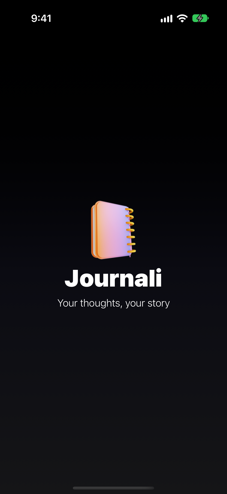
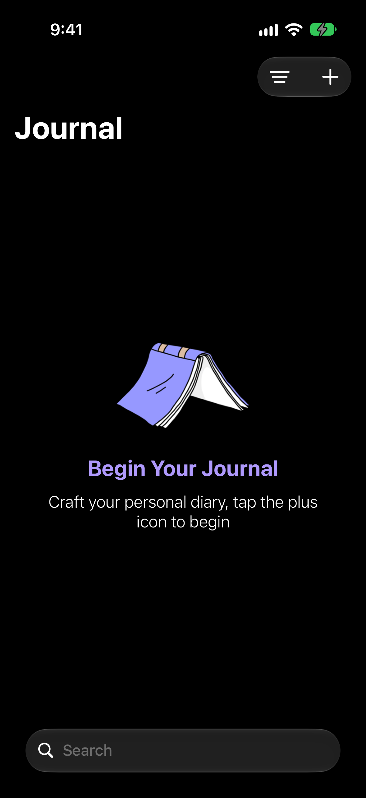
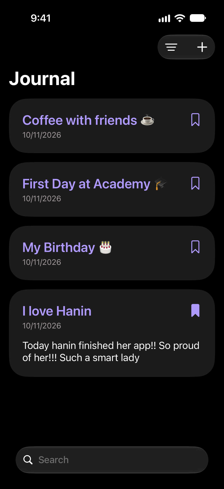
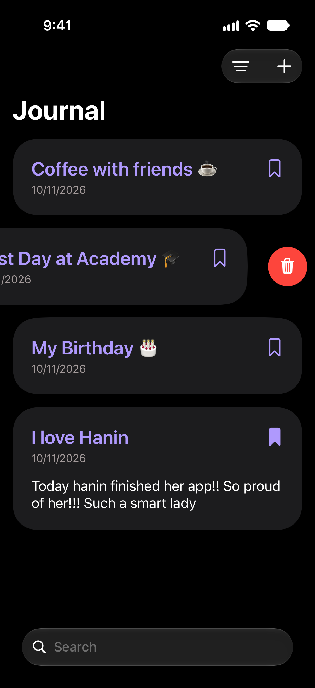

# 📔 Journali

**Your thoughts, your story.**

A simple journal app built with SwiftUI. Write your daily thoughts, bookmark the ones you love, and find any journal with search.

This app was built as part of a 10-day challenge to bring a provided UI design to life.
## 📱 Screenshots

<p align="center">
  
  
  
</p>

<p align="center">
  
  
  
  
</p>
---

## ✨ Features

- **Splash screen** that shows when the app opens
- **Empty state** when there are no journals yet
- **Add** a new journal with a title and text
- **Edit** a journal by tapping on it
- **Discard alert** when closing after making changes
- **Delete** a journal by swiping, with a confirmation alert
- **Bookmark** your favorite journals
- **Sort** by bookmark or by entry date
- **Search** inside titles and text
- **Liquid Glass** design (introduced in iOS 26)
- **Saved on device** so journals stay after closing the app

---

## 🛠 Built With

- Swift & SwiftUI
- iOS 27
- MVVM design pattern
- Liquid Glass

---

## 📁 Project Structure

```
Models/
├── JournalEntry.swift      → The journal data and sort options
└── Date+Format.swift       → Date formatting (dd/MM/yyyy)

ViewModels/
└── JournalViewModel.swift  → Add, edit, delete, bookmark, sort, and search

Views/
├── ContentView.swift       → Main journal page
├── SplashView.swift        → Splash screen
├── EmptyStateView.swift    → Empty state
├── JournalCardView.swift   → One journal card
└── JournalEditorView.swift → Add and edit sheet
```

---

## 📚 What I Learned

- How to structure an app using **MVVM**
- When to use **struct**, **class**, and **enum**
- How **Optional** values work (`if let`, `??`)
- How SwiftUI updates the screen with **@State**, **@Published**, and **Binding**
- How to use **sheets**, **alerts**, **swipe actions**, and **search**
- How to manage a project on **GitHub** with clear commits
- How to save data on the device with **Codable** and **JSON**

---

## ▶️ How to Run

1. Clone this repo
2. Open the project in **Xcode 27**
3. Choose an iPhone simulator
4. Press **⌘R**

---

👩‍💻 Made by **Hanin Alfehaid**
